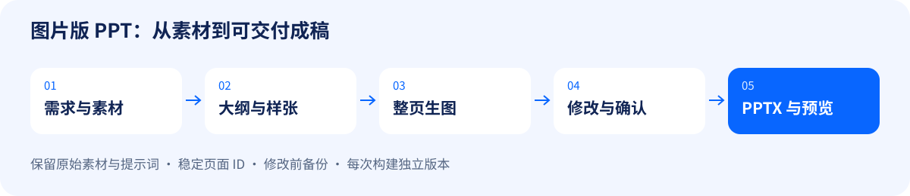
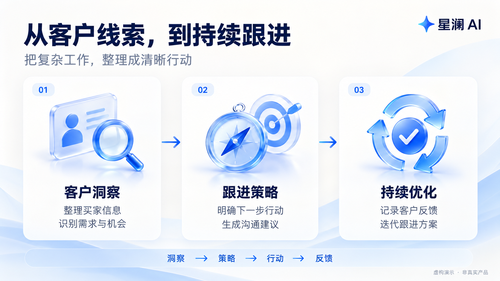

# image-ppt-workflow

一套面向视觉优先演示稿的 Codex Skill：**整页生图 → 局部改图 → 页面管理 → 图片合成 PPTX → 离线预览**。

适合产品介绍、会销稿和需要连续修改的图片版 PPT。成品以整页图片为主，文字和图表不能像原生 PowerPoint 对象一样单独编辑。

## 能做什么

- 保存需求、大纲、风格、逐页提示词及原始素材。
- 使用稳定页面 ID，支持新增、插页、换图和删除页面。
- 修改清单前自动备份；每次构建保存独立版本。
- 输出 16:9 高清 PPTX，可选轻量版，以及无需服务器的 HTML 翻页预览。
- 记录图片和成品 SHA256，方便核对历史版本。

## 图例

以下为内置图片工具生成的虚构品牌示例，不包含真实客户信息。完整提示词见 [图例提示词](examples/prompts.md)。

### 制作流程



### 成稿示例

封面：大标题与视觉主体。


内容页：三栏卡片与流程关系。



### 实际改图对比

请求：将标题“让每一次跟进，更接近成交”改成“把客户洞察，变成增长行动”，尽量保留其他内容与构图。

| 修改前 | 修改后 |
| --- | --- |
|  |  |

两张图片分别为实际生成、编辑结果。文案及主体布局已目视核对；生成式编辑不保证其他像素完全相同。

## 安装与调用

下载本仓库，将包含 `SKILL.md` 的整个文件夹命名为 `image-ppt-workflow`，放进 Codex 的技能目录：默认是用户目录下 `.codex/skills/`；使用自定义 `CODEX_HOME` 时放进其 `skills/` 子目录。重新打开会话后调用：

```text
使用 $image-ppt-workflow 制作一份图片版 PPT。
主题：……
受众与用途：……
页数：……
参考风格及素材：……
先制作三页样张，确认后完成整套，保留提示词与版本，交付高清版、轻量版和预览。
```

这是本地 Codex 技能包。仅上传到普通聊天窗口不等于安装本地技能；其他支持 SKILL.md 的代理环境需按其安装方式配置。

## 必要环境

| 用途 | 依赖 |
| --- | --- |
| 生图、改图 | 当前宿主提供的图片生成/编辑工具 |
| 管理页面、合成高清版 | Node.js、`pptxgenjs` |
| 额外生成轻量版 | `sharp` |
| 运行自动化测试 | Python 3（标准库即可） |

本技能不包含图片生成服务，也不提供 API Key。没有图片工具时仍可合成已有图片。不依赖 frontend-slides 或 baoyu-slide-deck。

优先使用宿主已有运行时；也可在新建的演示项目内执行 `npm install pptxgenjs sharp`。项目放在本仓库外，避免把演示素材提交到技能仓库。

## 脚本快速开始

下列路径是占位示例，请替换为实际绝对路径。`init` 的目标目录必须尚不存在。

```text
node <skill>/scripts/deck.cjs init --project <project> --title "产品介绍"
```

把生成的封面保存到 `<project>/renders/cover.png` 后运行：

```text
node <skill>/scripts/deck.cjs add --project <project> --id cover --title "封面" --image renders/cover.png
node <skill>/scripts/deck.cjs check --project <project>
node <skill>/scripts/deck.cjs build --project <project> --compact --version v001
```

依赖若安装在其他位置，给 `build` 加 `--modules <node_modules绝对路径>`。不需要轻量版时去掉 `--compact`。

结果位于 `<project>/output/v001/`，包括 `deck-hd.pptx`、`deck-compact.pptx` 和 `preview/index.html`。详细命令和修改流程见 [操作说明](references/operations.md)。

## 测试与局限

```text
python scripts/smoke_test.py --node <node可执行文件> --modules <node_modules目录> --fixture-a <图片A> --fixture-b <图片B> --workdir <测试输出目录>
```

测试创建独立项目，检查插页、替换、删除、历史版本、图片引用和 PPTX 内部结构。测试产物保留供检查。仍需视觉审阅：中文、金额、Logo、二维码以及图片编辑后非目标区域，都不能仅靠结构检查保证准确。

目前支持 PNG/JPEG；输出固定 16:9，其他比例完整居中放置在白底上。脚本不生成图片，不提取旧 PPT，不恢复原生可编辑元素。

## 仓库内容

- `SKILL.md`：代理执行流程。
- `agents/openai.yaml`：技能展示信息。
- `references/operations.md`：命令和清单格式。
- `scripts/deck.cjs`：页面管理与构建脚本。
- `scripts/smoke_test.py`：回归验证。

仓库不含演示稿、客户截图、密钥或个人素材。第三方依赖遵循各自许可。
