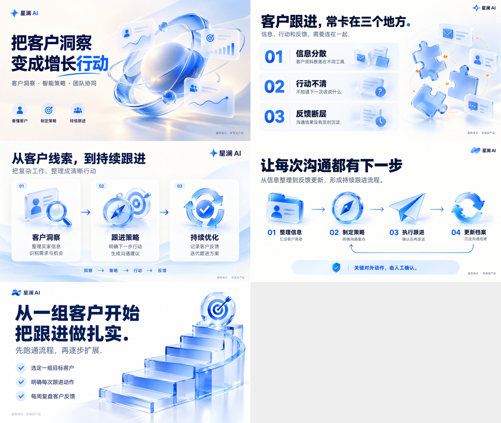

# 星澜 AI：五页完整案例

虚构品牌与业务场景，仅用于演示 image-ppt 的制作与修订流程，无真实客户数据或产品效果承诺。

- [高清版 PPTX](deck-hd.pptx)
- [轻量版 PPTX](deck-compact.pptx)
- 离线预览：下载完整案例后打开 `preview/index.html`。GitHub 文件页显示的是 HTML 源码。
- 页面图片：`images/`；完整提示词：`prompts/`；页面顺序与稳定 ID：`manifest.json`。

## 页面

1. 封面：把客户洞察，变成增长行动
2. 业务痛点：客户跟进，常卡在三个地方
3. 核心能力：从客户线索，到持续跟进
4. 跟进流程：让每次沟通都有下一步
5. 行动建议：从一组客户开始，把跟进做扎实

## 复现构建

在此案例目录安装依赖：`npm install pptxgenjs sharp`，然后从仓库根目录运行：

```sh
node scripts/deck.cjs check --project examples/xinglan-demo
node scripts/deck.cjs build --project examples/xinglan-demo --compact --version rebuilt-v001
```

使用宿主现成依赖时可加 `--modules <node_modules绝对路径>`。每次构建使用新版本名。

构建会复用保存的图片，不会重新生图；从提示词重新生成的画面不保证完全一致。整页图片中的文字不能作为原生 PowerPoint 文本编辑。

## 修订记录与检查

封面初稿保留在 `history/cover-before.png`。标题由“让每一次跟进，更接近成交”改为“把客户洞察，变成增长行动”，实际修改提示词见 `prompts/original-examples.md`。其余页面按业务痛点、能力、流程、行动建议构成完整叙事。

五页使用内置图片工具制作并目视核对文字。蓝白配色和玻璃插画贯穿全稿；示例标识图形由生成模型绘制，各页存在差异，不作为严格品牌标识复用案例。

高清版与轻量版均已用 PowerPoint 打开并导出五页画面，检查页面顺序和内容。页面清单检查通过，无尺寸警告。


